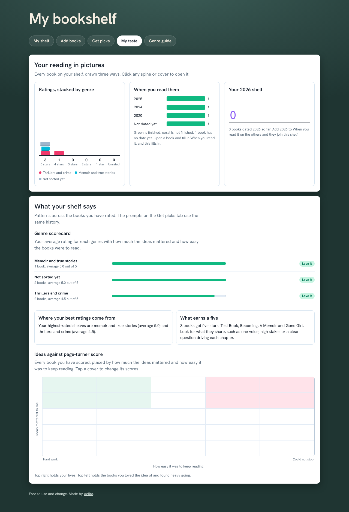

# Bookshelf

A free bookshelf that learns what you like to read, then writes the prompt for your own chatbot to recommend what to read next.

No sign-up, no server, no cost. Your books stay in your browser. The recommendations come from the chatbot you already use (Claude, ChatGPT or Gemini, free plans work).

## What it does

- **My shelf**: your books on a wooden shelf, sorted by genre
- **Add books**: type them in, or import your Goodreads export
- **Get picks**: builds a ready-to-paste prompt from your ratings, for any chatbot
- **My taste**: shows what earns a five from you and what makes you stop
- **Genre guide**: explains how genres fit together and where you sit

## Try it

Open the live page: **https://lifeofaelita.github.io/bookshelf/**

Or download this repo and open `index.html` in any browser. Nothing to install.

## Make it yours in five steps

1. **Add your books.** On Add books, upload your Goodreads file (Goodreads: My Books, Import and export, Export library) or add books one at a time.
2. **Open each book you care about** and set your rating, how much the ideas mattered and how easy it was to keep reading. Ten rated books is enough to start.
3. **Open Get picks**, choose how many picks you want, and press the button.
4. **Press Copy** and paste into Claude, ChatGPT or Gemini.
5. **Tell the chatbot what you thought** and ask for another round. Add the new books back into the page when you finish them.

## Weekly picks

The page does not send emails, because there is no server. Two free options:

- Paste the prompt into a chat and ask for new picks every Monday. If your chatbot plan offers scheduled tasks, you can set that up there, but features differ by plan.
- Put a repeating reminder in your calendar: "Monday: get book picks". It takes two minutes.

## Your data

Everything is saved in your browser on your device. Clearing browser data erases it, so use **Back up my shelf** now and then. You can restore the file on any device.

## Prompts

The `prompts/` folder holds plain versions you can use without the page: build a taste profile, weekly picks, check a single book, and sort books into shelves.

## Host your own copy for free

1. Fork or download this repo.
2. In GitHub, open Settings, Pages, choose the `main` branch and the root folder, and save.
3. Your page appears at `https://YOUR-NAME.github.io/bookshelf/` after a minute.

## Testing

See [TESTING.md](TESTING.md).

## Credits

Built by [Aelita](https://github.com/lifeofaelita) with Claude. Sample books are examples only, and the ratings on them are made up. Book covers come from Open Library when your import includes an ISBN.

Licence: MIT.
