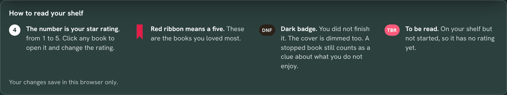
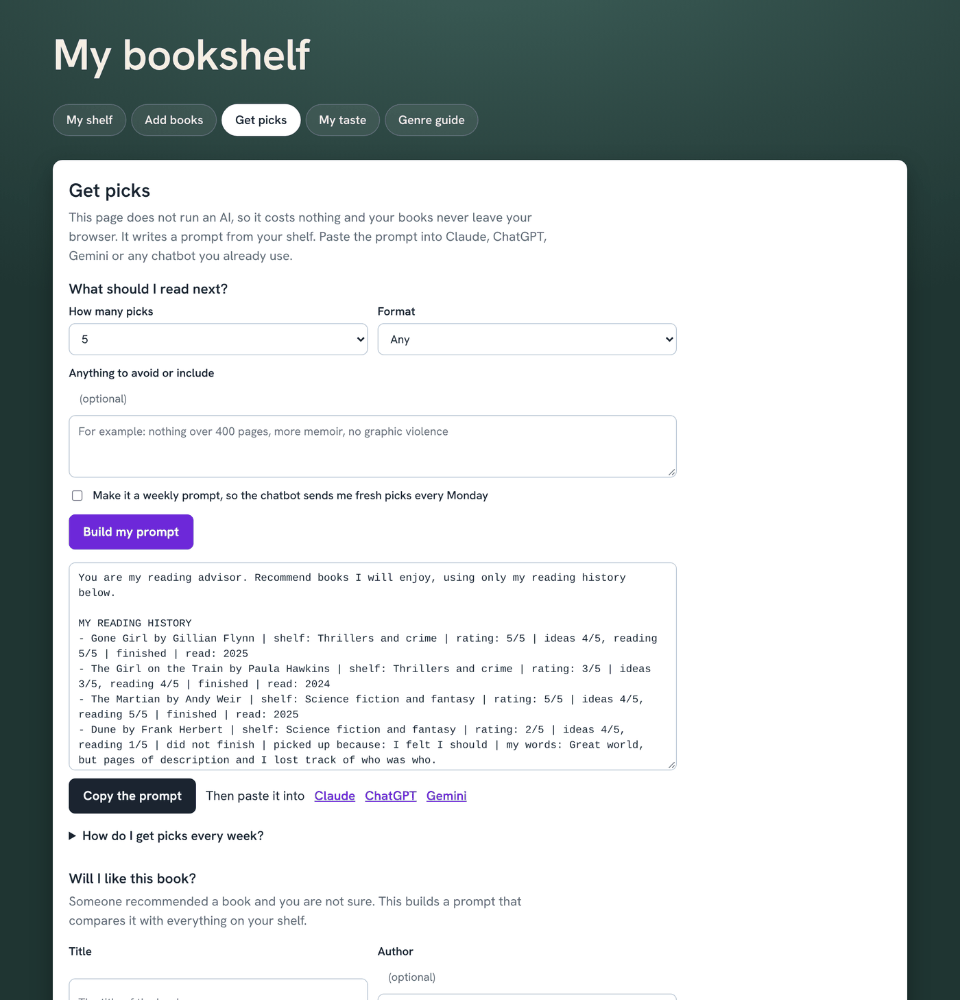
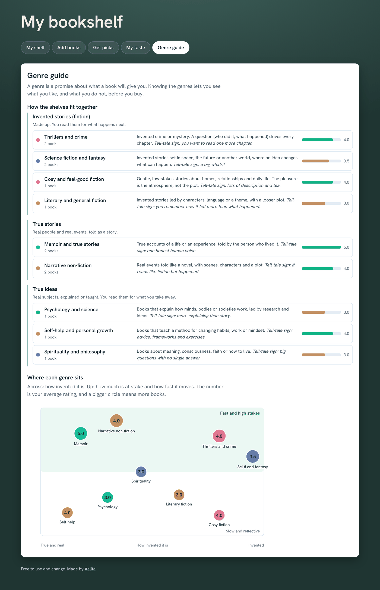

# Bookshelf

A free bookshelf that learns what you like to read, then writes the prompt for your own chatbot to recommend what to read next.

**[Open the live bookshelf](https://lifeofaelita.github.io/bookshelf/)**. There is nothing to install, no account to make and nothing to pay for.


## What it does, and what it does not

Most book apps ask for a star rating and stop there. This one asks two questions about every book: how much the ideas mattered to you, and how easy it was to keep reading. That second score is what explains why you gave up on a book you were sure you would love.

- It shows your books on a wooden shelf, sorted by genre.
- It works out what earns a five from you and what makes you stop.
- It writes a ready-made prompt from your shelf. You paste that prompt into Claude, ChatGPT or Gemini and the chatbot suggests what to read next.
- It does not contain a chatbot, send emails or collect your data. That is why it costs nothing.

## Why not Kindle or Kobo recommendations?

Kindle and Kobo learn from what you buy and how many stars you give. That works while your taste stays put. Mine did not. Over the years my style changed so much that the suggestions kept describing a reader I no longer was, because every old purchase counted as much as last month's.

A star rating also hides the reason behind it. A three-star book might have been brilliant and heavy going, or easy and forgettable, and a store cannot tell which. The two scores here separate those cases, and a book you gave up on tells the chatbot something too.

## Why I built it

I am 39 and I am still finding out what I like to read. For years I loved the idea of the books I was supposed to read, then struggled once I started them. This year was about learning what I enjoy and being fine with the fact that not every book has to be educational. The bookshelf is how I keep track of that, and it is why the reading score sits next to the ideas score.

## Want it all done for you?

Skip the page and the guide. Copy this into Claude, ChatGPT, Gemini or any chatbot you already use. It asks about your books one step at a time, works out the scores and gives you picks. The same text is in [prompts/00-do-it-all-for-me.md](prompts/00-do-it-all-for-me.md).

<details>
<summary>Show the prompt to copy</summary>

```
You are my reading advisor. I want you to learn my taste and then recommend what to read next. Do all the work for me and keep it easy: ask me one thing at a time, in plain language.

STEP 1. Ask me for up to 10 books I have read. For each one ask for the title, the author if I know it, and a few words on what I thought, including any book I stopped reading and why. Carry on with whatever I give you as long as it is at least 3 books, and tell me that more books give better picks.

STEP 2. From my words, work out three scores out of 5 for each book:
- Rating: how much I enjoyed it overall.
- Ideas: how much the subject or story stayed with me.
- Reading: how easy it was to keep turning the pages, judged by pace, structure and voice.
Base every score only on what I said. If my words do not say enough, ask me one short question instead of guessing. Show the scores in a table and ask me to correct any that look wrong.

STEP 3. Use these rules when you read the scores:
- A book with high ideas and low reading is a problem with the style, not with the topic.
- A book I did not finish tells you about style and pacing, even when I did not say why.
- A book I read only because I felt I should is weaker evidence about my topics than one I chose with enthusiasm.
- Books I read recently count more than books from long ago.

STEP 4. Tell me what you have noticed in four or five sentences: what earns a five from me and what makes me stop. Name books from my list.

STEP 5. Recommend 5 books I have not read. For each one give the title and author, the genre, two scores out of 100 (ideas fit and how easy it will be to keep reading), one sentence of reasoning that names a book from my list, and one thing to watch out for. Order them by overall match, weighting ease of reading at 60 percent and ideas fit at 40 percent. If you are not sure a book exists, leave it out.

STEP 6. Tell me I can come back to this chat any week, say what I have read, finished or dropped, and you will give me fresh picks without repeating a book.
```

</details>

## Start in five minutes

1. **Open the page.** Go to the live link above. You will see 13 sample books so you can look around first.
2. **Add your own books.** Open the **Add books** tab and pick whichever option suits you (see below). When your own books are in, press **Clear the sample books** on the shelf.
3. **Rate a few.** Click a book to open it, then set your rating and the two scores. Ten rated books is enough for good picks. Three is the minimum.
4. **Get your prompt.** Open **Get picks**, choose how many picks you want and press **Build my prompt**, then **Copy the prompt**.
5. **Paste it into a chatbot.** Use the Claude, ChatGPT or Gemini links under the prompt. Free plans work.

## Four ways to add books


Aim for about 10 books with a rating, because that is when your patterns start to show. The page accepts as few as three, but the picks stay general until you add more.

| Option | Best for | How |
| --- | --- | --- |
| Start from ten titles | Anyone with no Goodreads history | Paste ten books you have read into a chatbot with [prompts/06-first-shelf-from-ten-books.md](prompts/06-first-shelf-from-ten-books.md). It writes a file you import, plus suggested Ideas and Reading scores for you to check. |
| Import from Goodreads | Anyone with a long reading history | On Goodreads open **My Books**, then **Import and export**, then **Export Library**. Download the file, then choose it under **Import from Goodreads** on the Add books tab. Books you already have are skipped. |
| Add one book | A short list, or books you read recently | Fill in the form on the Add books tab. Only the title is required. |
| Import from another app | StoryGraph users | Export your library as a CSV file and import it the same way. The common column names are recognised, but not every export has been tested. |

Imported books land on the right shelf when the genre is clear, and on **Not sorted yet** when it is not. Open a book to move it. The file [prompts/04-sort-my-books.md](prompts/04-sort-my-books.md) shows how to ask a chatbot to sort a long list for you.

## How the two scores work

Open any book and you will see three controls.


| Control | The question to ask yourself | A 1 means | A 5 means |
| --- | --- | --- | --- |
| Rating | Did I enjoy this book overall? | I disliked it | I loved it |
| Ideas | Did the subject or story stay with me, so that I kept thinking about it afterwards? | It left no mark | I still think about it |
| Reading | Was it easy to keep turning the pages? | A slog, and I pushed through or stopped | I could not put it down |

Ideas is about what the book gave you, not about how it was written. For a novel, read it as the story, the characters and what they made you think about. Reading is about the writing itself: the pace, the structure and the voice.

Take a book on sleep science that fascinated you and that you still talk about, but that read like a textbook. You might give it a rating of 3, ideas 5 and reading 2. That tells the chatbot the topic suits you and the style does not, so it should suggest a lighter, story-led book on the same subject instead of another heavy one.

A few more rules the prompt passes on to the chatbot:

- A book you did not finish is a clue about style, even when you do not say why.
- A book you read because you felt you should counts for less than one you chose with enthusiasm. Mark this under **Why you picked it up**.
- Recent reads count more than old ones. Fill in **When you read it** to help.

The shelf also has a key, **How to read your shelf**, that explains the number badges, the red ribbon (a five), the dark DNF badge and the TBR badge.




## Getting your recommendations



**What should I read next?** (the Get picks tab)

- Choose 3, 5 or 8 picks.
- Choose a format: any, ebook or paperback, or audiobook.
- Add anything to avoid or include, for example "nothing set in wartime".
- Tick the weekly box if you want a repeating prompt (see below).

**Will I like this book?** (also on the Get picks tab)

Type a title that someone recommended. The prompt asks the chatbot to compare it with your shelf and score the ideas fit and ease of reading out of 100. If the chatbot does not recognise the book, it should say so and mark its confidence as low.

Always glance at the picks before you buy. Chatbots occasionally invent books, and the prompt tells them to leave out any title they are unsure exists.

## Picks every week

The page cannot email you, because it has no server. You have three options, all free:

| Option | How |
| --- | --- |
| Ask the chatbot to repeat it | Tick the weekly box, paste the prompt into a new chat and ask for fresh picks every Monday. |
| Use the chatbot's own scheduling | ChatGPT has a Tasks feature and Claude has scheduled tasks on some plans. Plans change, so check what yours offers. |
| Set a calendar reminder | A repeating Monday reminder that says "get book picks". Update your shelf first so the prompt includes last week's reading. |

## Sale watch

If you buy ebooks, you can ask a chatbot which wishlist books are worth buying when they drop in price. The page cannot watch prices itself, so you paste your wishlist with today's prices, or let a chatbot that can browse check them. The prompt is in [prompts/05-sale-watch.md](prompts/05-sale-watch.md), along with free price-alert services such as eReaderIQ and BookBub.

## Your data and privacy

- Everything is saved in your browser on your device. Nothing is uploaded to a server.
- It is saved per browser and per device. A different computer, or a private window, starts empty.
- Clearing your browser data erases the shelf. Press **Download a backup** now and then. To move to a new device, open the page there and press **Restore from a backup**.
- **Start again** erases everything and asks you to tap twice so it cannot happen by accident.
- Book covers load from Open Library when an imported book has an ISBN. Books without one get a coloured cover with the title.

## If something goes wrong

| Problem | Fix |
| --- | --- |
| The shelf is empty after I came back | You are in a different browser, a private window or on another device. Restore your backup file. |
| The import added no books | Make sure you chose the exported CSV file and that it has a Title column. |
| Most books are on Not sorted yet | Open a book to choose its shelf, or ask a chatbot to sort the list with prompts/04-sort-my-books.md. |
| The Build my prompt button asks for more ratings | Rate at least three books first. |
| The Copy button does not work | Click inside the prompt box and press Ctrl+C or Cmd+C. |

## Use it without the page

The **prompts** folder holds plain-text versions you can paste straight into a chatbot: do everything for you, build a taste profile, weekly picks, check a single book, sort books into shelves, and build your first shelf from ten books.

## Run your own copy

1. Press **Fork** at the top of this repository, or download it with **Code, Download ZIP**.
2. To open it on your computer, unzip it and double-click **index.html**.
3. To host it free on GitHub Pages: in your fork open **Settings**, then **Pages**, choose the **main** branch and the **/ (root)** folder, and press Save. Your page appears at your-name.github.io/bookshelf after a minute or two.

The code is one HTML file plus the **fonts** and **wood** folders. There is nothing to build.



## Checking it works

[TESTING.md](TESTING.md) is a 15-minute checklist covering the page, a phone and a chatbot. [examples/sample-goodreads-export.csv](examples/sample-goodreads-export.csv) is a small file you can use to try the import.

## Credits

Built by [Aelita](https://github.com/lifeofaelita) with Claude. The sample books are examples only and their ratings are made up. Licence: MIT, so you are free to use and change it.
