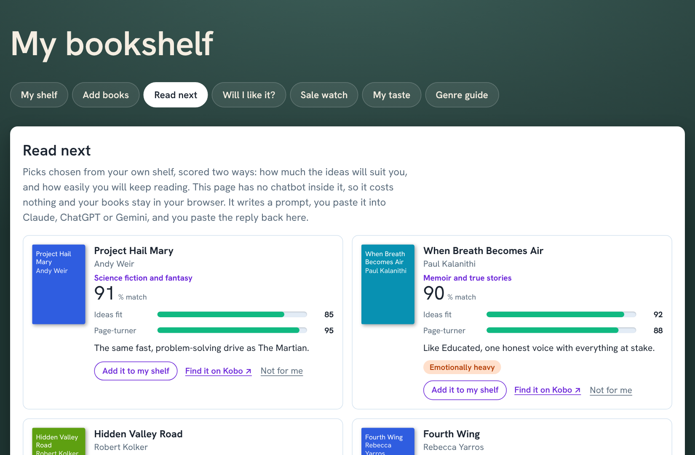
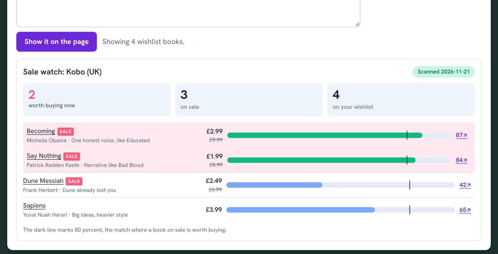

# Bookshelf

A free bookshelf that learns what you like to read, then writes the prompt for your own chatbot to recommend what to read next.

**[Open the live bookshelf](https://lifeofaelita.github.io/bookshelf/)**. There is nothing to install, no account to make and nothing to pay for. Hold Ctrl (or Cmd on a Mac) while you click to open it in a new tab and keep this page open.


## What it does, and what it does not

Most book apps ask for a star rating and stop there. This one asks two questions about every book: how much the ideas mattered to you, and how easy it was to keep reading. That second score is what explains why you gave up on a book you were sure you would love.

- It shows your books on a wooden shelf, sorted by genre.
- It works out what earns a five from you and what makes you stop.
- It writes a ready-made prompt from your shelf. You paste that prompt into Claude, ChatGPT or Gemini and the chatbot suggests what to read next.
- It does not contain a chatbot, send emails or collect your data. That is why it costs nothing.

## Why not Kindle or Kobo recommendations?

Kindle and Kobo learn from what you buy and how many stars you give. That works while your taste stays put. Mine did not. Over the years my style changed so much that the suggestions kept describing a reader I no longer was, because every old purchase counted as much as last month's.

A star rating also hides the reason behind it. A three-star book might have been brilliant and heavy going, or easy and forgettable, and a store cannot tell which. The two scores here separate those cases, and a book you gave up on tells the chatbot something too.

## Why I built it

I am 39 and I am still finding out what I like to read. For years I loved the idea of the books I was supposed to read, then struggled once I started them. This year was about learning what I enjoy and being fine with the fact that not every book has to be educational. The bookshelf is how I keep track of that, and it is why the reading score sits next to the ideas score.

## Two ways to use it

- **One link, and your chatbot sets it up (fastest).** You paste one line into Claude, ChatGPT or Gemini. It asks which books you have read, asks you to rate each one, and hands you a block to paste into the page. Go to [Set it up with one link](#set-it-up-with-one-link).
- **Do it yourself on the page.** You build the shelf by hand or from a Goodreads export. Go to [Start in five minutes](#start-in-five-minutes).

Either way the page does the display and your chatbot does the thinking. Each tab writes a prompt, you paste it into a chatbot, and you paste the reply back to see it as cards. Nothing leaves your browser, and no account is needed.

## Start in five minutes

1. **Open the page.** Go to the live link above. You will see 13 sample books so you can look around first.
2. **Add your own books.** Open the **Add books** tab and pick whichever option suits you (see below). When your own books are in, press **Clear the sample books** on the shelf.
3. **Rate a few.** Click a book to open it, then set your rating and the two scores. Ten rated books is enough for good picks. Three is the minimum.
4. **Get your picks.** Open **Read next**, choose how many picks you want and press **Build my prompt**, then **Copy the prompt**.
5. **Paste it into a chatbot, then paste the reply back.** Use the Claude, ChatGPT or Gemini links under the prompt. Free plans work. Copy the whole reply, paste it into the box under the prompt and press **Show it on the page**. Your picks appear as cards.

## Keeping your shelf safe

The page stores your shelf in your browser, so clearing cookies or site data erases it. On the Add books tab, use **Download a backup**, or press **Copy my shelf for my chatbot**, paste it into Claude, ChatGPT or Gemini and ask it to save the copy in a Project, document or note. To restore, ask the chatbot for your bookshelf block and paste it into the page.

## Ways to add books


Aim for about 10 books with a rating, because that is when your patterns start to show. The page accepts as few as three, but the picks stay general until you add more.

| Option | Best for | How |
| --- | --- | --- |
| Let your chatbot do it | Anyone who wants the least effort | Copy the one line from the top of the **Add books** tab into a chatbot, answer its questions and paste the block it gives you back into the page. See [Set it up with one link](#set-it-up-with-one-link). |
| Start from ten titles | Anyone with no Goodreads history | Paste ten books you have read into a chatbot with [prompts/06-first-shelf-from-ten-books.md](prompts/06-first-shelf-from-ten-books.md). It writes a file you import, plus suggested Ideas and Reading scores for you to check. |
| Import from Goodreads | Anyone with a long reading history | On Goodreads open **My Books**, then **Import and export**, then **Export Library**. Download the file, then choose it under **Import from Goodreads** on the Add books tab. Books you already have are skipped. |
| Add one book | A short list, or books you read recently | Fill in the form on the Add books tab. Only the title is required. |
| Import from another app | StoryGraph users | Export your library as a CSV file and import it the same way. The common column names are recognised, but not every export has been tested. |

Imported books land on the right shelf when the genre is clear, and on **Not sorted yet** when it is not. Open a book to move it. The file [prompts/04-sort-my-books.md](prompts/04-sort-my-books.md) shows how to ask a chatbot to sort a long list for you.

## How the two scores work

Open any book and you will see three controls.


| Control | The question to ask yourself | A 1 means | A 5 means |
| --- | --- | --- | --- |
| Rating | Did I enjoy this book overall? | I disliked it | I loved it |
| Ideas | Did the subject or story stay with me, so that I kept thinking about it afterwards? | It left no mark | I still think about it |
| Reading | Was it easy to keep turning the pages? | A slog, and I pushed through or stopped | I could not put it down |

Ideas is about what the book gave you, not about how it was written. For a novel, read it as the story, the characters and what they made you think about. Reading is about the writing itself: the pace, the structure and the voice.

Take a book on sleep science that fascinated you and that you still talk about, but that read like a textbook. You might give it a rating of 3, ideas 5 and reading 2. That tells the chatbot the topic suits you and the style does not, so it should suggest a lighter, story-led book on the same subject instead of another heavy one.

A few more rules the prompt passes on to the chatbot:

- A book you did not finish is a clue about style, even when you do not say why.
- A book you read because you felt you should counts for less than one you chose with enthusiasm. Mark this under **Why you picked it up**.
- Recent reads count more than old ones. Fill in **When you read it** to help.

The shelf also has a key, **How to read your shelf**, that explains the number badges, the red ribbon (a five), the dark DNF badge and the TBR badge.


## What each tab does

| Tab | What it gives you |
| --- | --- |
| My shelf | Your books on a wooden shelf, with ratings, ribbons and the key. |
| Add books | A one-line setup for your chatbot, Goodreads import, one-book form and backup. |
| Read next | Picks scored on ideas fit and page-turner, each with a match percentage, **Add it to my shelf** and **Find it on** your store. |
| Will I like it? | Type a book someone recommended and get a match score, reasons and cautions. Keep the ones you want on a to-read pile. |
| Sale watch | Which wishlist books are worth buying while they are on sale. |
| My taste | Your reading in pictures, a scorecard by genre, and findings written from your own ratings. A chatbot can write a deeper version. |
| Genre guide | Every major genre explained with a drawing, even the ones you have not tried. |



### Read next and Will I like it?

The picks and the match scores come from your chatbot, and the page does the sum. Your chatbot scores each book twice out of 100, for ideas fit and for how easily you will keep reading. The page then weights reading at 60 percent and ideas at 40 percent, so a brilliant idea you cannot get through does not rank first. For books you are unsure about, the chatbot says so and marks its confidence as low.

Pick where you buy your books (Kobo UK or US, Kindle UK or US, or Bookshop.org) and every card gets a **Find it on** link that opens a search for that book in your store. Always glance at the picks before you buy. Chatbots occasionally invent books, and the prompt tells them to leave out any title they are unsure exists.

### Picks every week

The page cannot email you, because it has no server. You have three options, all free:

| Option | How |
| --- | --- |
| Come back and rebuild the prompt | Update your shelf, press **Build my prompt** on Read next and paste the reply back. It takes about a minute. |
| Use the chatbot's own scheduling | ChatGPT has a Tasks feature and Claude has scheduled tasks on some plans. Plans change, so check what yours offers. |
| Set a calendar reminder | A repeating Monday reminder that says "get book picks". |

### Sale watch



Your chatbot reads your wishlist and scores each book against your shelf. The page then shows the ones that are on sale and score 80 or more as **worth buying now**, with the price, the old price and a link to the book.

There are two ways to get the wishlist to the chatbot:

- **Let it browse.** Use a chatbot that can use your browser, such as Claude in Chrome or ChatGPT's agent mode. Sign in to your Kobo or Amazon account yourself when it asks. The prompt tells it to only read: it must never type your password, add anything to a basket or buy anything.
- **Paste it.** Copy your wishlist (titles, authors and prices) into the box on the Sale watch tab and the prompt carries it for you.

Free price-alert services such as eReaderIQ and BookBub are also listed in [prompts/05-sale-watch.md](prompts/05-sale-watch.md).

## Set it up with one link

You do not need to touch the page until the end. Your chatbot does the interview, and you paste one block into the page.

**What happens**

1. You paste one line into a chatbot.
2. It asks for your books. If you have a Goodreads, StoryGraph or Kobo export, give it that and it asks far fewer questions. Otherwise it asks for 10 or more titles.
3. It asks you to rate each book from 1 to 5 on three questions: Rating, Ideas and Reading (the table above). It also asks whether you finished it, why you picked it up and roughly when you read it.
4. It shows you the scores to correct, tells you what it has noticed about your taste, and gives you a block of data.
5. You paste that block into the **Add books** tab. Your shelf appears.
6. It then offers three extras: first picks, a taste write-up and a sale scan of your Kobo or Kindle wishlist. Each one comes back as another block that you paste into the matching tab.

| | The one-line way | The copy-and-paste way |
| --- | --- | --- |
| Best for | Anyone on a phone, or anyone who wants the least effort | A chatbot that cannot open links, or anyone who wants to read the instructions before sending them |
| Works with | Chatbots that can open links, such as Claude, ChatGPT and Gemini. On free plans this can depend on whether browsing is switched on. | Any chatbot at all |
| What you do | Paste one line and send it | Copy a block of text, paste it and send it |

### The one-line way

Paste this into your chatbot and send it. The **Add books** tab on the page has the same line with a copy button. If the chatbot says it cannot open the link, use the copy-and-paste way instead.

```
Read https://raw.githubusercontent.com/lifeofaelita/bookshelf/main/for-chatbots.md and follow the instructions in it.
```

### The copy-and-paste way

1. Open [for-chatbots.md](for-chatbots.md) and press the copy icon at the top right of the file.
2. Paste it into a new chat with Claude, ChatGPT, Gemini or any other chatbot, and send it.
3. Answer the questions, then paste the block it gives you into the **Add books** tab.

## Use it without the page

The **prompts** folder holds plain-text versions you can paste straight into a chatbot: do everything for you, build a taste profile, weekly picks, check a single book, sort books into shelves, and build your first shelf from ten books. They answer in plain text. The page and the one-link setup use the data-block versions, which the page can turn into cards.

## Your data and privacy

- Everything is saved in your browser on your device. Nothing is uploaded to a server.
- It is saved per browser and per device. A different computer, or a private window, starts empty.
- Clearing your browser data erases the shelf. Press **Download a backup** now and then. To move to a new device, open the page there and press **Restore from a backup**.
- **Start again** erases everything and asks you to tap twice so it cannot happen by accident.
- Book covers load from Open Library when an imported book has an ISBN. Books without one get a coloured cover with the title.

## If something goes wrong

| Problem | Fix |
| --- | --- |
| The shelf is empty after I came back | You are in a different browser, a private window or on another device. Restore your backup file. |
| The import added no books | Make sure you chose the exported CSV file and that it has a Title column. |
| Most books are on Not sorted yet | Open a book to choose its shelf, or ask a chatbot to sort the list with prompts/04-sort-my-books.md. |
| The Build my prompt button asks for more ratings | Rate at least three books first. |
| The Copy button does not work | Click inside the prompt box and press Ctrl+C or Cmd+C. |

## Run your own copy

1. Press **Fork** at the top of this repository, or download it with **Code, Download ZIP**.
2. To open it on your computer, unzip it and double-click **index.html**.
3. To host it free on GitHub Pages: in your fork open **Settings**, then **Pages**, choose the **main** branch and the **/ (root)** folder, and press Save. Your page appears at your-name.github.io/bookshelf after a minute or two.

The code is one HTML file plus the **fonts** and **wood** folders. There is nothing to build.


## Checking it works

[TESTING.md](TESTING.md) is a 15-minute checklist covering the page, a phone and a chatbot. [examples/sample-goodreads-export.csv](examples/sample-goodreads-export.csv) is a small file you can use to try the import.

## Credits

Built by [Aelita](https://github.com/lifeofaelita) with Claude. The sample books are examples only and their ratings are made up. Licence: MIT, so you are free to use and change it.
